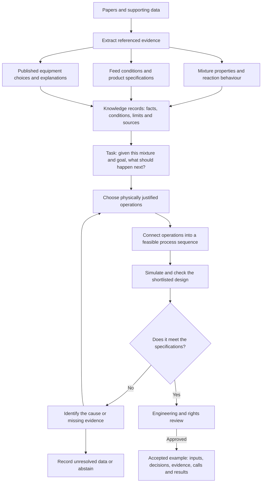
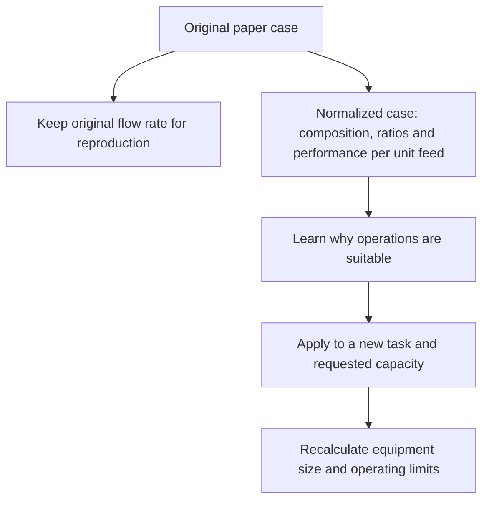

# How we build the dataset

Agreed design, 2026-10-29. Physical evidence guides operation selection; simulation checks a small justified shortlist. Published flowsheets are worked examples, not automatically optimal answers.

## What comes from papers

| Layer | Inputs extracted | Dataset purpose |
|---|---|---|
| Physical evidence | Mixture phase behaviour, azeotropes, volatility, solubility, kinetics, thermal limits, conditions and uncertainty | Establish feasible mechanisms and applicability |
| Engineering decisions | Obstacles, operation purpose, physical mechanism, alternatives and selection criteria | Explain why an operation is suitable |
| Process examples | Feed composition/state, specifications, connectivity, settings and reported results | Reproduce and verify a connected sequence |

Every fact needs a source ID, page/table/equation locator, original units, conditions, evidence type and limitations. Distinguish measurements, author simulations, assumptions and our calculations. Pure-component properties alone do not establish mixture separability. Missing explanations remain unknown; do not invent the authors' rationale.

## Example input and expected output

The model receives feed or reactor-outlet composition/state, product specifications, relevant constraints and optionally requested capacity. It can retrieve applicable evidence and call tools. The target identifies the obstacle, gives a concise physical justification for shortlisted operations, specifies verification calls and interprets their actual results. It can ask for missing information or abstain.

Keep task inputs separate from reviewed target decisions and verification outputs. Do not expose the answer through an input flowsheet when evaluating operation selection. Reproduction tasks may supply that flowsheet explicitly.

## Knowledge-guided design steps

1. Define feed state, products and constraints.
2. Identify the physical obstacle and relevant evidence.
3. Generate a small set of physically justified operations; explain exclusions.
4. Build a feasible process sequence. Connect selected operations so resulting streams meet product specifications and process constraints. Explain each operation's purpose, suitability and remaining work. Recovery, recycle and waste treatment apply only when relevant.
5. Simulate shortlisted sequences, check feasibility, determine settings and equipment requirements, and compare sensitivity. Simulation tests justified choices rather than searching arbitrary combinations.

Label rationales as author-stated, independently-supported, simulation-tested or unresolved-hypothesis. Store supporting references and contrary evidence. Passing a balance does not prove physical accuracy or optimality. Process-wide trade-offs may require reconsidering the reaction section.

## Capacity and normalization

Declare the normalization basis, units, formula and source for each transformation. For example, 1 kmol of feed is an amount basis, not a flow rate. Conversion and recovery are dimensionless; residence time and specific energy retain their units. Keep original values alongside derived values.

Capacity is not a memorized restriction. It may still affect technology selection and is required for sizing. Do not linearly scale equipment dimensions, heat-transfer performance, pressure drop or economics without justification. New capacity variants need recalculation and remain in the same family split as their parent case.

## Repository workflow and acceptance

Use [evidence.template.json](../dataset/evidence.template.json) for individual facts, [decision.template.json](../dataset/decision.template.json) for operation choices, and [example.template.json](../dataset/example.template.json) for linked process cases. These are draft scaffolds, not validated schemas or accepted examples.

First draft prepared: [extraction and feed conditioning](../dataset/drafts/ethyl-acetate-extraction/README.md). Next connect operation decisions to CHEPTA calculations and existing validation. Preserve its published balance discrepancies as qualifications; investigate during reproduction without making them the main learning objective. No new physical claims or accepted targets are created by this design document.

Review provenance, applicable conditions, reasoning, actual simulation results and rights before release. Keep paper/process/capacity variants together when splitting data. Evaluate new compositions and specifications, appropriate abstention, and selection rationale—not just agreement with a published equipment list. No training starts with this documentation update.

## Division of responsibility

Reuse CHEPTA property models, parameter provenance and existing validation. Lab checks applicability to components, conditions and required calculation; it does not routinely remeasure or revalidate phase equilibrium. Investigate underlying data only for a concrete missing parameter, range violation or material disagreement. Process-level balance and performance checks still apply.

Literature supplies process reasoning and worked examples. CHEPTA supplies thermodynamic calculations. Reference the engine revision and applicable validation evidence; do not interpret the mere presence of a package as coverage of every mixture.
