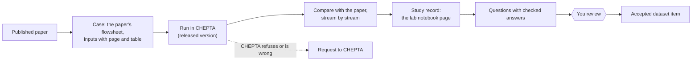

# How it works, in plain words

Written 2026-11-12 for the maintainer, a chemical engineer who is not an AI researcher.

## 1. The goal

A collection of worked process-engineering problems. Each comes from a published paper, is rebuilt in CHEPTA, and has
every number traced either to the paper or to an actual CHEPTA run. It serves two purposes:

- **testing an AI assistant**: give it a problem and check whether it uses CHEPTA correctly, notices missing
  information and tells the truth about what failed;
- **perhaps teaching one later** ("training"): a much later, separate decision, with an outside service.

## 2. The work, step by step

1. **Pick a paper** whose process CHEPTA can plausibly run, and whose numbers can be reused.
2. **Build the case**: copy the flowsheet, the feeds, the unit settings and the paper's results, each with its page,
   table or figure.
3. **Run it in CHEPTA**, through the same command line an AI assistant would use.
4. **Compare** CHEPTA's streams with the paper's. Keep every difference, warning and refusal.
5. **Tell CHEPTA** what it refused or got wrong (a "capability request"). CHEPTA's own sessions fix it in a later
   release, and Lab re-runs the case.
6. **Write questions with checked answers** from the case.
7. **You review** them. Only then do they count.

## 3. What one dataset item looks like

A question with a checked answer. The three drafts so far:

| Kind | Question | Checked answer, in short |
|---|---|---|
| Explain a paper's choice | "Why do these authors cool the ethyl acetate azeotrope before extraction, and why is colder not always better?" | Cooling enriches ester in the organic phase, but more wash water loses ester; the net benefit depends on recovery and downstream duties. Each claim points to a passage of the paper |
| Choose the next operation | "Ethyl acetate / ethanol / water: what operation should we consider next?" | Azeotropy alone does not decide it: first composition, purity, impurity limits, recovery and utilities, then a shortlist |
| Run CHEPTA and interpret | "Run this ethanol reactor request. Does a successful run prove a valid process?" | No: it ran, but its warnings say the ethanol + water parameters are used outside their temperature range |

An assistant is scored on whether its answer agrees with the checked one: right numbers from real runs, warnings
reported, nothing invented, missing information asked for.

## 4. What we record for each case (the "study record")

A lab notebook page, as a file the computer can check:

| Entry | Example: the benzene + toluene column |
|---|---|
| Which paper, page, figure | The ChemSep Book, pp. 11–17, Figures 1.19–1.21 |
| Which CHEPTA version | `chepta` 0.6.0 |
| Exactly what CHEPTA was given | the input file: 10 stages, feed on stage 5, reflux ratio 2, Peng-Robinson |
| Exactly what CHEPTA answered | the output file, unchanged, with a fingerprint so that nobody can edit it quietly |
| Warnings and refusals | "purity specifications come with milestone M4" (refused) |
| Comparison with the paper | stage temperatures within 0.80 K, compositions within 0.018 |
| What was assumed, what is unknown | the book assumed constant molar overflow; CHEPTA solves energy balances |
| Who reviewed it | nobody yet |

The fingerprints and file formats are there so a record cannot change without anyone noticing. The table above is
the substance; you do not need to read the JSON.

## 5. Kinds of numbers we keep apart

| Kind | Example |
|---|---|
| Measured | an experiment reported in a paper |
| Published simulation | the paper's own Aspen or ChemSep results |
| Simulated by CHEPTA | our runs |
| Assumed | a value we had to choose, with the reason |
| Derived | a conversion or a balance we calculated |

A match between CHEPTA and a published simulation means two models agree, not that either matches a plant.

## 6. Why so far only pieces

| Case | What was simulated |
|---|---|
| Ethanol to ethylene | the reactor only |
| Benzene + toluene | one column |
| Methanol separator | one flash drum |
| Ethyl acetate plant | nothing yet; the paper's 56 streams and 19 units copied and their balances checked |

Two reasons. CHEPTA could not run these plants until release 0.6.1 (columns with purity targets, acetic acid in a
column). And the earlier work built a lot of checking structure before having real cases to put in it.

**From now on, a case is a complete flowsheet from one paper**, compared stream by stream, before any question is
written from it. First: the ethyl acetate plant (Piotrowski & Kubica 2021, conventional design); fallback: CO2 to
methanol.

## 7. What "accepted" requires

Since 2026-11-12 (AGENTS.md, "Review by AI with a person's spot check"):

| Who | Checks |
|---|---|
| A separate AI review session (not the one that built the case) | everything: every number against its source, every unit and method choice, every decision's reason, the licence. It writes a short review note and picks 2 or 3 items for you |
| You | only those 2 or 3 items: the ones that most affect the results, the one it was least sure of, one picked at random |

Both checks are recorded with names and dates. If one of your items is wrong, the whole case is checked again.

The held-out test questions (used to score an assistant) are also reviewed by you or by an AI of another company, so
that Claude does not grade itself (AGENTS.md, rule on the independent check).
