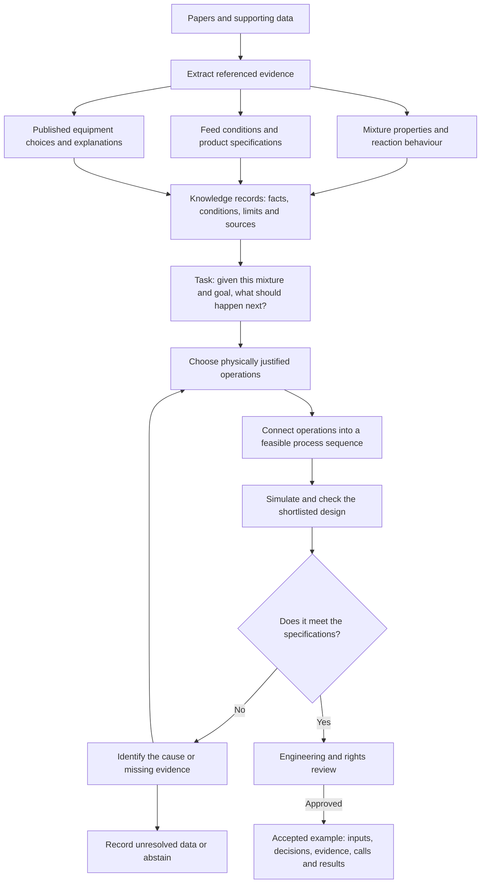
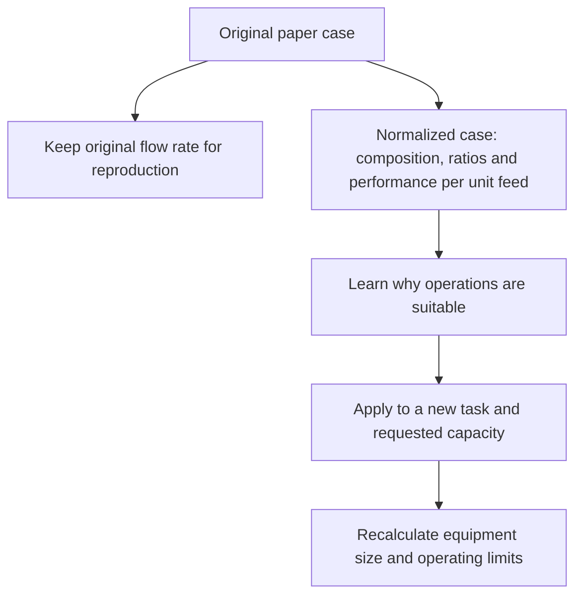
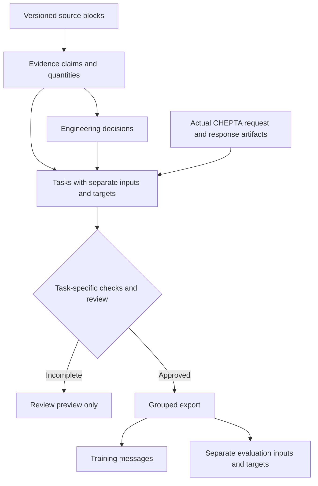

# Process design: how operations are chosen, and how the dataset learns it

The method a senior process engineer follows, applied to every case and to every design question in the dataset: from
the feed, the products and the constraints to a short list of physically justified operations, checked by simulation.
What Lab has learned so far, problem by problem, is in [data/ISSUES_AND_ROUTES.md](../data/ISSUES_AND_ROUTES.md); a worked example is
[the ethyl acetate operation reasoning](../dataset/drafts/ethyl-acetate-extraction/OPERATION_REASONING.md).
(Formerly docs/reference/DATASET_DESIGN.md, "How we build the dataset"; moved and renamed 2026-11-20, content unchanged below.)

## How we build the dataset

Agreed design, 2026-10-29. Physical evidence guides operation selection; simulation checks a small justified shortlist. Published flowsheets are worked examples, not automatically optimal answers.

## What comes from papers

| Layer | Inputs extracted | Dataset purpose |
|---|---|---|
| Physical evidence | Mixture phase behaviour, azeotropes, volatility, solubility, kinetics, thermal limits, conditions and uncertainty | Establish feasible mechanisms and applicability |
| Engineering decisions | Obstacles, operation purpose, physical mechanism, alternatives and selection criteria | Explain why an operation is suitable |
| Process examples | Feed composition/state, specifications, connectivity, settings and reported results | Reproduce and verify a connected sequence |

Every fact needs a source ID, page/table/equation locator, original units, conditions, evidence type and limitations. Distinguish measurements, author simulations, assumptions and our calculations. Pure-component properties alone do not establish mixture separability. Missing explanations remain unknown; do not invent the authors' rationale.

## Example input and expected output

The model receives feed or reactor-outlet composition/state, product specifications, relevant constraints and optionally requested capacity. It can retrieve applicable evidence and call tools. The target identifies the obstacle, gives a concise physical justification for shortlisted operations, specifies verification calls and interprets their actual results. It can ask for missing information or abstain.

Keep task inputs separate from reviewed target decisions and verification outputs. Do not expose the answer through an input flowsheet when evaluating operation selection. Reproduction tasks may supply that flowsheet explicitly.

## Knowledge-guided design steps

1. Define feed state, products and constraints.
2. Identify the physical obstacle and relevant evidence.
3. Generate a small set of physically justified operations; explain exclusions.
4. Build a feasible process sequence. Connect selected operations so resulting streams meet product specifications and process constraints. Explain each operation's purpose, suitability and remaining work. Recovery, recycle and waste treatment apply only when relevant.
5. Simulate shortlisted sequences, check feasibility, determine settings and equipment requirements, and compare sensitivity. Simulation tests justified choices rather than searching arbitrary combinations.

Label rationales as author-stated, independently-supported, simulation-tested or unresolved-hypothesis. Store supporting references and contrary evidence. Passing a balance does not prove physical accuracy or optimality. Process-wide trade-offs may require reconsidering the reaction section.

## From design basis to a base case

Douglas’s hierarchy orders the decisions that shape a flowsheet. For a new design, keep a record of what is decided at each level and which downstream finding would reopen it. For a paper reproduction, record the authors’ choices first. [Douglas (1985), *AIChE Journal*](https://doi.org/10.1002/aic.690310302) · [Seay, §2.2.1, five design levels](https://etd.auburn.edu/bitstream/handle/10415/1035/Seay_Jeffrey_51.pdf)

| Decision | What to establish before adding detail |
|---|---|
| 1. Mode of operation | Record the throughput or campaign basis and whether batch or continuous operation fits it. Identify which part a steady-state run can represent. |
| 2. Feeds and outlets | Draw the overall boundary. Balance saleable products, by-products and waste at the required purity and recovery. Identify where each impurity leaves. |
| 3. Reaction and recycle | Establish conversion and selectivity on a stated basis. Check how reactant recovery and purge losses change fresh-feed demand and circulating flow. |
| 4. Separation | Use mixture behaviour to shortlist sequences. Include solvent recovery or regeneration when the route needs it. Close material balances before ranking. |
| 5. Heat recovery | Compare heating and cooling loads at their temperature levels. Count heat recovery only where a feasible temperature approach exists. Revisit the sequence if its utility needs make it unattractive. |

## Screen a separation

**First, two questions from the same book** (de Haan & Padding, *Process Technology*, 2nd ed., De Gruyter 2022, Tab. 2.1–2.2 ([publisher preview](https://api.pageplace.de/preview/DT0400.9783110712445_A43234342/preview-9783110712445_A43234342.pdf))):
- **Is the mixture homogeneous or heterogeneous?** A heterogeneous mixture (solid–liquid, gas–solid, gas–liquid, two
  liquids) is split first by a *mechanical* separation, using gravity, centrifugal force or impingement: settlers,
  filters, centrifuges, cyclones, scrubbers. A homogeneous mixture needs a *molecular* separation, between two phases of
  different composition.
- **What creates the second phase?** Either an *energy* separating agent (heat or refrigeration: evaporation,
  distillation, crystallization, drying) or a *mass* separating agent (a solvent, an absorbent, a stripping gas, an
  adsorbent, a membrane). A mass separating agent brings its own recovery step and losses, and the comparison must
  include them.

The book groups molecular separations by the property that differs: volatility, solubility, solubility or melting
point, adsorbability, and permeability. The rows below follow these groups.

Use each row as a candidate mechanism. The last column gives the first discriminating check. Confirm property data and unit coverage in the pinned release before offering a CHEPTA result. de Haan & Padding, *Process Technology*, 2nd ed., De Gruyter 2022, Tab. 2.1–2.2 ([publisher preview](https://api.pageplace.de/preview/DT0400.9783110712445_A43234342/preview-9783110712445_A43234342.pdf))

| Mixture evidence | Candidate | First check for this feed and target |
|---|---|---|
| Vapour and liquid enrich different components | Flash for a single equilibrium contact, distillation for repeated contacts | Check equilibrium compositions at the operating pressure over the path to the target. Compare purity **and** recovery, and identify any intervening azeotrope. [Northwestern, “Separation processes”](https://processdesign.mccormick.northwestern.edu/index.php/Separation_processes) |
| An azeotrope blocks the requested split | Pressure-swing distillation | Compare azeotropic compositions at two feasible pressures. Can streams from the two columns cross the composition limit and meet both product targets? [Abildskov & O’Connell (2015)](https://backend.orbit.dtu.dk/ws/portalfiles/portal/102749656/On_the_Responses_of_Azeotropes.pdf) |
| An azeotrope that splits into two liquids, or an entrainer that makes one | Azeotropic (heterogeneous) distillation with a decanter and entrainer recycle | Check that the overhead vapour condenses into two liquids at the decanter temperature, with tie lines putting the entrainer and the product in different layers. Count entrainer losses and make-up. de Haan & Padding, Tab. 2.1 (azeotropic distillation); the [ethyl acetate case](../cases/ethyl-acetate-piotrowski-2021/README.md) is a worked example |
| A solvent changes the relative volatility of the key pair | Extractive distillation with solvent recovery | Check selectivity along the separation path, solvent carryover and the recovery column. [Gerbaud et al. (2019), review of extractive distillation](https://doi.org/10.1016/j.cherd.2018.09.020) |
| Feed and solvent can form two liquids | Liquid–liquid extraction, followed by recovery where needed | Locate the feed–solvent mixing point. Use tie lines at the operating temperature to check where the solute and valuable product go. Count losses in both phases. [LearnChemE, Hunter–Nash method](https://learncheme.com/quiz-yourself/interactive-self-study-modules/hunter-nash-method-for-liquid-liquid-extraction/hunter-nash-method-for-lle-summary/) |
| A gas component dissolves selectively in a liquid, or a dissolved gas must leave a liquid | Gas absorption; stripping with a gas or steam | Check the solubility (Henry's constant or VLE) at the operating pressure and temperature, the absorbent rate it implies, and how the absorbent is regenerated. de Haan & Padding, Tab. 2.1 |
| One component adsorbs much more strongly on a solid | Adsorption (gas or liquid), with regeneration | Obtain an isotherm for the mixture at the conditions. Check capacity against the load, and how and how often the bed is regenerated. de Haan & Padding, Tab. 2.1 |
| Solubility falls enough on cooling or solvent removal | Crystallization | Use a solubility curve to bound yield and product left in the mother liquor. Identify the solid form and any missing purity evidence. [Northwestern, “Crystallization”](https://processdesign.mccormick.northwestern.edu/index.php/Separation_processes#Crystallization) |
| A membrane selectively transports a component | Membrane separation | Obtain permeability or permeance and selectivity for the relevant mixture and conditions. Compare achievable purity and recovery at the available driving force. de Haan & Padding, Tab. 2.1 |

**Worked decision.** For the ester case, “an azeotrope exists” leaves several routes open. To evaluate water extraction, ask whether the cooled feed plus wash water forms two liquids, how much ethanol reaches the aqueous phase, and how much ester it carries away. Compare final ester recovery and downstream duties at the same product specification. The source reports sensitivity to cooling and extractant circulation. Its conclusion applies to that feed and flowsheet. [Piotrowski & Kubica (2021), §3.3](https://doi.org/10.3390/pr9081425)

**From screening to development.** Compare feasible routes at the same feed, saleable product rate or explicit normalization, impurity limit, recovery and utility basis. Record solvent makeup, waste, utility temperature levels and excluded equipment. Vary the uncertain input most likely to change the ranking. When two inputs plausibly interact, test their combinations. If the ranking reverses, identify the decision-changing datum to measure next. For a capacity change, identify the transfer or equipment constraint that needs a sizing calculation or pilot measurement. [Douglas (1985)](https://doi.org/10.1002/aic.690310302) · [NIST, design of experiments](https://itl.nist.gov/div898/handbook/pmd/section3/pmd31.htm)

## Capacity and normalization

Declare the normalization basis, units, formula and source for each transformation. For example, 1 kmol of feed is an amount basis, not a flow rate. Conversion and recovery are dimensionless; residence time and specific energy retain their units. Keep original values alongside derived values.

Capacity is not a memorized restriction. It may still affect technology selection and is required for sizing. Do not linearly scale equipment dimensions, heat-transfer performance, pressure drop or economics without justification. New capacity variants need recalculation and remain in the same family split as their parent case.

## Repository workflow and acceptance

Use [the canonical corpus and pipeline](../dataset/PIPELINE.md) for new training tasks. The formal schema links source blocks, evidence, decisions, runs and tasks. Older templates remain research scaffolds; their schema versions are separate from the canonical corpus schema. No record is accepted merely by migration.

First draft prepared: [extraction and feed conditioning](../dataset/drafts/ethyl-acetate-extraction/README.md). Next connect operation decisions to CHEPTA calculations and existing validation. Preserve its published balance discrepancies as qualifications; investigate during reproduction without making them the main learning objective. No new physical claims or accepted targets are created by this design document.

Review provenance, applicable conditions, reasoning and rights before every task release; require actual runs and appropriate comparisons when the target claims calculated results. Explanations and conditional selections can be reviewed without full-process execution. Full process-performance exports remain blocked until their acceptance contract is implemented. Keep paper/process/capacity variants together when splitting data. Evaluate new compositions and specifications, appropriate abstention, and selection rationale—not just agreement with a published equipment list. No training starts with this documentation update.

## Division of responsibility

Reuse CHEPTA property models, parameter provenance and existing validation. Lab checks applicability to components, conditions and required calculation; it does not routinely remeasure or revalidate phase equilibrium. Investigate underlying data only for a concrete missing parameter, range violation or material disagreement. Process-level balance and performance checks still apply.

Literature supplies process reasoning and worked examples. CHEPTA supplies thermodynamic calculations. Reference the engine revision and applicable validation evidence; do not interpret the mere presence of a package as coverage of every mixture.

## Implemented data path

The first implementation covers literature explanation, conditional next-operation selection and numerical-benchmark replay. Retrieval indexing, automatic task generation, full-process performance gates and model training remain future work. Known answer-revealing blocks are excluded from selection inputs; human context review is still needed to catch semantic leakage. Both current family groups are deliberately unassigned until a suitable evaluation corpus exists.

## Research-informed handoff and evaluation

Apply [the four-paper methods review](reference/RELATED_WORK_METHODS.md) using existing evidence and decision records. Each operation handoff states its required stream change, supporting physics, applicable conditions, known specifications, unresolved inputs and acceptance result. Keep this engineering description separate from simulator syntax.

Preserve source, proposed and executed flowsheets as distinct states. Inferred settings and simplifications remain explicit; convergence of a modified configuration does not verify the original task. Evaluate reproduction, source extraction and new-design selection separately, allowing physically defensible alternatives in the last track. Review consequential conclusions against their evidence even when tool values are correct.

These are methodology requirements; automated handoffs, change tracking and the expanded evaluation remain to be implemented through the delivery plan.
