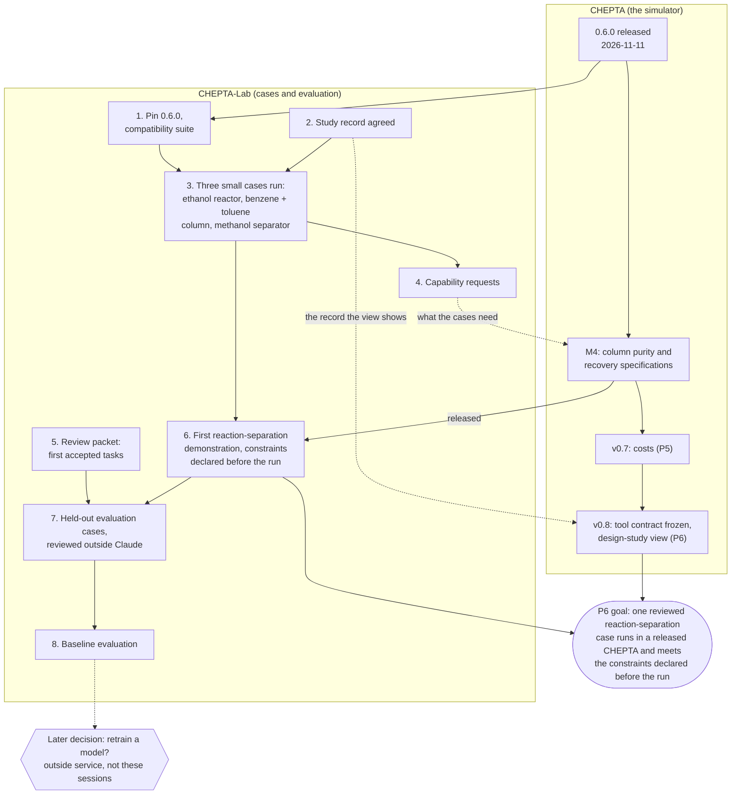

# Where we are heading

Written 2026-11-11 by CHEPTA-Lab's coordinating session, for the maintainer, who asked: "I do not have yet a clear
vision of where this is heading, maybe the roadmap is not clear for me. Explain me the next steps, including how to
integrate these new concepts if needed."

This page explains; it decides nothing. The decisions for the maintainer are in section 6. What was read and what
could not be read is in section 7.

## 1. The two projects

**CHEPTA is the simulator.** It calculates: properties, phase equilibria, reactors, columns, flowsheets with recycles,
and later costs. Every number in it comes from an open source. It runs in a browser, from a command line and as a tool
an AI assistant can call. Its ambition (CHEPTA ROADMAP, "Where CHEPTA is going") is "an open process-design studio
where AI agents do the legwork and engineers make the decisions".

**CHEPTA-Lab is the test bench and the casebook.** It reads the open literature, turns published processes into cases
with every value traced to its source, runs those cases in a released CHEPTA, keeps the results (failures included),
and builds from them worked examples and evaluations that measure how well an AI assistant uses the simulator. Lab
never changes the simulator.

**How they fit together** (CHEPTA ROADMAP, "CHEPTA and CHEPTA-Lab", rules 1 to 7):

| | CHEPTA | CHEPTA-Lab |
|---|---|---|
| Owns | the simulator, its data, its tool interface (G1), the design-study view (G6) | literature screening, cases, worked examples, evaluations (G2 to G5) |
| Gives the other | released versions on npm; an answer to each capability request | capability requests (what a real case needed and CHEPTA refused); reviewed cases as benchmarks |
| Never | takes a model's output as a source of numbers (rule 4) | changes CHEPTA's code; uses an unreleased CHEPTA without saying so (rule 1) |

In one sentence: Lab finds out, on real published processes, what CHEPTA can and cannot yet do, and CHEPTA closes the
gaps release by release.

**A warning about names.** The two repositories reuse the same labels for different things:

| Label | In CHEPTA | In CHEPTA-Lab ([DELIVERY_PLAN.md](DELIVERY_PLAN.md)) |
|---|---|---|
| M4 | column purity and recovery specifications, side draws (proposal 0015) | "targeted corpus expansion" (100 to 200 reviewed tasks) |
| P5 / P05 | phase P5: costs, release v0.7 | work packet P05: a small development evaluation |
| P6 | phase P6: agentic design with Lab, release v0.8 | not used |

In this page, M4, P5 and P6 always mean CHEPTA's. Lab's own labels are written "Lab M4", "Lab P05".

## 2. Where things stand on 2026-11-11

**CHEPTA.** Version 0.6.0 is on npm (checked today: `npm view chepta` gives 0.6.0, MIT). New since 0.5.0, by CHEPTA's
handover: "PR + gE (MHV1)" and "SRK + gE (MHV1)", the Pipe block with gas-liquid flow, two-liquid labels, membrane,
absorber and stripper, extraction, evaporator, crystallizer, Wilson.

In work in CHEPTA: column purity and recovery specifications and side draws (M4); reproducible two-liquid labels; an
interface reorganization (proposal 0021, reported by CHEPTA's coordinator; not yet on CHEPTA's `main`, so not read).

**CHEPTA-Lab.** Built with Astra 6 until 2026-10-30; moved to Claude today.

| What exists in Lab | State |
|---|---|
| Catalogue: 8 sources, 6 candidate process families | consistent (`validate_catalog.py` passes); not all sources reusable |
| Ethanol to ethylene reactor case | 6 runs executed and numerically checked, on an **old** CHEPTA commit (2026-10-29); source pressure units unresolved; no human review |
| Ethyl acetate comparison (two plant configurations) | 56 streams and 19 units extracted and balance-audited; full plant not runnable |
| Dataset pipeline (schemas, gates, export) | works; 9 evidence claims, 3 decisions, 3 draft tasks; **0 accepted tasks** |
| Capability audit of CHEPTA | by reading the code at a commit of 2026-10-30; out of date (extraction and absorber now exist) |
| Run through the released package, command line or MCP | **not done yet** |
| Evaluation of any model; training | not done |

**Lab's known blockers** (from CHEPTA's handover; each must be confirmed by an actual run on 0.6.0, step 3):

| Blocker | Hits which case | Status in CHEPTA |
|---|---|---|
| Acetic acid dimerization in columns | ethyl acetate | not built |
| Three-phase flash in columns | ethyl acetate | listed as a blocker; to re-test on 0.6.0 |
| Purity and recovery specifications on columns | every separation with a product specification | in work (M4) |
| Costs | route comparison | P5, v0.7 |

## 3. The next steps for Lab

| # | Step | What it produces | What the maintainer does |
|---|---|---|---|
| 1 | **Pin `chepta@0.6.0`** and run the small compatibility suite (today: the six ethanol runs) against it | the new pin recorded; a table "old result, new result, new warnings"; old runs keep their old version | read the table; approve the pin |
| 2 | **Agree the study record**: the one file Lab hands to CHEPTA per study (case and sources, CHEPTA version, exact inputs, outputs, checks, warnings, assumptions, review status) | a two-page proposal and a schema; CHEPTA's coordinator confirms its view (G6) can show it | approve the list of fields; decide the two format questions of section 4 (A1, A4) |
| 3 | **Run three small cases** through CHEPTA's command line or MCP server, the same way an assistant would: the ethanol reactor, the benzene + toluene column, the methanol separator with PR + gE (MHV1) | three study records with actual results, warnings and failures kept | compare the transcribed inputs with their sources (an AI check never counts for this) |
| 4 | **File capability requests** for what step 3 refused or got wrong | one request per gap, with the case, CHEPTA's message and the evidence, sent to CHEPTA's coordinator | confirm the priority order |
| 5 | **Review packet** for the 9 evidence claims and 3 draft tasks already collected (Lab P02) | a short packet: source passage, value, question for the reviewer | review it; the first accepted tasks come from here, and only from a person |
| 6 | **First reviewed reaction-separation demonstration**. Needs the M4 column specifications in a released CHEPTA. Product purity, recovery and operating limits are written down **before** the run | one complete case: reactor, separation, recycle if any, balances closed, constraints met or the failure kept | choose the case (recommendation in section 6); review inputs and result |
| 7 | **Held-out evaluation cases**: cases an assistant is scored on and never sees beforehand. Reviewed by the maintainer or by a model of another family (for example Astra 6); no Claude session that writes CHEPTA code sees them (rule 7) | a small frozen set, kept apart, each case with the name of who reviewed it | review them, or name the outside model; decide where they are kept (section 6) |
| 8 | **Baseline evaluation**, then the training decision | scores of an existing assistant on the held-out set, errors sorted by cause | decide whether retraining a model is worth it (see below) |

Steps 1 and 2 can start at once and run side by side. Step 5 does not depend on the others. Step 6 waits for CHEPTA.

**What "training" means here.** Two different things carry that word:

| | Building the training and test material | Retraining a model's weights |
|---|---|---|
| What it is | cases, worked examples (question, tool calls, checked answer), evaluations | changing the model itself with those examples ("fine-tuning") |
| Where | in these sessions, in this repository | **not possible in these sessions**; needs an outside service and paid compute |
| When | now: steps 1 to 7 | a later, separate decision after step 8, and only if the baseline shows a weakness that examples can cure |

Most of the value is in the first column: a reviewed casebook and an honest evaluation are useful to any assistant,
retrained or not. Often an assistant improves more from better tool messages and better instructions than from
retraining; step 8 tells which.

## 4. The new concepts, and whether to integrate them

### A. ChemE-as-Code (TU Delft, Artur M. Schweidtmann's group)

What it is, from their own pages (read 2026-11-11): "chemical plants as open, machine-readable files in git". A plant
is a folder: `plant.yaml`, `process/materials.yaml`, `process/flowsheet.yaml`, `process/simulation.yaml`, P&IDs in
DEXPI 2.0.1, `checks/checks.yaml`, a life-cycle folder. A command, `cheme validate`, lists what is inconsistent or
missing; stage gates (concept, basic, detail) pass only when the checks pass and a person other than the author signs.
Each value is marked given (with its source), assumed or calculated. Simulations run in DWSIM or IDAES, outside their
package, exchanging JSON. Their Process Atlas lists 103 processes (102 at concept stage, 1 at screening), none
independently reviewed, described by them as "AI-generated research output, not engineering advice". The preprint is
arXiv:2611.07947 (5 November 2026). Code: AGPL-3.0-or-later. Process data: CC BY 4.0. It is "research software in
active development", days old.

How close it is to what we do: very. Same conviction (plain files, sources on every value, checks by tools, a person
signs), different end of the plant: they go wide (P&ID, layout, HAZOP, cost, LCA) with borrowed simulators; we go deep
on the simulation and on measuring the assistant.

| # | Idea | Recommendation | Reason |
|---|---|---|---|
| A1 | Write or export Lab's cases in their plant-folder format | **Later; prepare now.** In step 2, add a table mapping each field of Lab's study record to their files. Export the first case after step 6 | Their format is days old and may change before their 1.0. Lab's record is narrower (one study, its runs, its sources) and must first serve CHEPTA's view. A mapping table costs little and keeps the door open, so the work stays reusable |
| A2 | CHEPTA as a third simulation backend of their toolkit | **Later; CHEPTA's decision, not Lab's.** Passed to CHEPTA's coordinator as a note for bridge item B6 (phase P8) | It fits technically: their backends are separate programs that exchange JSON, and CHEPTA's command line already does that. But the adapter would live in their AGPL repository. CHEPTA is MIT: it must not copy their code, only read and write their files. Needs their agreement (A5) |
| A3 | Their Atlas as a source of candidate cases | **Adopt now, as leads only.** | It lists processes close to ours (ethanol dehydration to ethylene, a methanol loop, phenol from cumene; no ethyl acetate). But it is AI-generated and unreviewed: **never a source of numbers**, for Lab or for CHEPTA's databank (rule 4: "a model's output is never a source"). Each value of a Lab case still needs an open primary source. Any use is credited (CC BY 4.0) |
| A4 | Their validation gates as a pattern for Lab's checks | **Adopt two ideas now** (ideas, not code), in step 2 | Lab already has gates and reviews tied to a digest of the content. Worth borrowing: (1) a ladder for each case, kept apart from review: *sourced*, then *balanced*, then *simulated and converged*; "gates passing is not a review". (2) every finding carries a stable rule name, the file and a hint, so an assistant knows what to fix |
| A5 | Collaboration with the TU Delft group | **The maintainer's decision. Recommendation: later**, after step 3, when there are real runs to show | A first contact is stronger with a working case and a concrete offer (A2). Nothing is lost by waiting some weeks |
| A6 | No MCP server, by their design (their decision record 0007) | **Nothing to change** | They want agents to edit files and call a command line. CHEPTA offers both a command line and an MCP server, and Lab uses those. No conflict |

One finding of their paper supports our own rules: with planted faults, their checks caught only what the rules
covered, so checks "support rather than replace human review". That is the reason for rule 7 and for the person's
check of numbers.

### B. Plant ontologies for troubleshooting (LinkedIn post by Scott Duncan)

The idea, as the maintainer described it: link equipment, instruments, control loops, historian tags, maintenance
records and documents of an **operating** plant so an AI can help troubleshoot; the comments stress keeping it current
through management of change, and human validation of what the AI says. The post itself could not be read from here.

| # | Idea | Recommendation | Reason |
|---|---|---|---|
| B1 | A plant ontology in Lab or CHEPTA | **Not now.** A note for the far future | It concerns operations and troubleshooting of a running plant. CHEPTA and Lab work on design: steady-state simulation of processes from the literature. No instruments, tags or maintenance records exist in our cases |
| B2 | Its two lessons: keep it current; a person validates | **Already adopted** | Lab's reviews are bound to the exact content reviewed and lapse when it changes; AI drafting never counts as review |

## 5. The path from now to CHEPTA's P6 goal

P6's goal, in CHEPTA's roadmap: "one reviewed reaction-separation case of CHEPTA-Lab runs through the supported
interface in a released CHEPTA, meets the product and operating constraints declared before the run".

The maintainer appears in every box of the lower row: they check inputs against sources, approve the record, choose
the case and review the held-out set. Costs (v0.7) help the comparison of routes; by CHEPTA's roadmap "a missing cost
does not hold back the engineering demonstration".

## 6. What the maintainer must decide

| # | Decision | Recommendation |
|---|---|---|
| D1 | Start steps 1 and 2 now? | **Yes.** Two routine worker sessions, one task each |
| D2 | Which case for the first reaction-separation demonstration (step 6)? | **CO2 to methanol** (reactor, cooling, flash, recycle, methanol + water column), provisionally. It avoids the acetic acid blocker of ethyl acetate, and its separator became possible with MHV1. Confirm after step 3 and after the paper's supplement is audited |
| D3 | Where are held-out evaluation cases kept, so that no CHEPTA-writing session sees them (step 7)? | **A separate private repository**, attached only to Lab's evaluation sessions. Not needed before step 7 |
| D4 | Who reviews the held-out cases? | **The maintainer for the numbers; Astra 6 as a second opinion**, recorded with its name and date |
| D5 | ChemE-as-Code format (A1) | **Mapping table now, export later** |
| D6 | Borrow the "sourced, balanced, simulated" ladder and named findings (A4) | **Yes**, inside step 2 |
| D7 | The Atlas as leads, never as numbers (A3) | **Yes** |
| D8 | Contact the TU Delft group (A5); offer CHEPTA as a backend (A2) | **Later**, after step 3; A2 also needs CHEPTA's coordinator |
| D9 | Plant ontologies (B1) | **Not now** |

**Chosen by the maintainer, 2026-11-11:** "do only steps 1 to 4; leave for now the Atlas thing, it can be done later;
also the whole plant as code can be done later". So steps 1 to 4 start now (D1 yes). D5 to D8 (everything about
ChemE-as-Code, the Atlas included) are postponed: the study record of step 2 carries no mapping to their format and
borrows nothing from them for now. D2, D3, D4 and D9 wait until they are needed (steps 6 and 7).

## 7. What was read, and what was not

| Read | How |
|---|---|
| CHEPTA at commit 50cd2cb (2026-11-11): ROADMAP.md, docs/HANDOVER.md, the decision file on Lab moving to Claude, docs/models/columns.md (limits table) | read-only copy |
| npm: `chepta` 0.6.0, MIT, commands `chepta` and `chepta-mcp` | `npm view` |
| This repository: README, AGENTS.md, PROJECT_PLAN, DELIVERY_PLAN, capability audit, candidates, pipeline guide | directly; `validate_catalog.py` run and passing |
| ChemE-as-Code: home page, docs index, schema reference (first part), process guide, stages and gates, provenance, calculation maturity, list of 47 decision records, records 0007, 0014, 0039, Atlas home and process list, arXiv abstract page | web pages, through an automatic summarizer |

| Not read | Why |
|---|---|
| The LinkedIn post by Scott Duncan and its comments | LinkedIn is not readable from this session, and a web search did not find it. Section 4B rests on the maintainer's description only |
| CHEPTA proposal 0021 (interface reorganization) | not on CHEPTA's `main` yet |
| The ChemE-as-Code preprint in full, their source code, and the last nine tenths of their schema reference | abstract and documentation only; the field-by-field mapping of A1 will need the full schemas |
| Any individual Atlas process | only the list of titles was read; no number was taken from it |

Nothing in this page was calculated or simulated. The ChemE-as-Code figures (103 processes, 47 decision records,
licences) are quoted from their pages as they stood on 2026-11-11.
