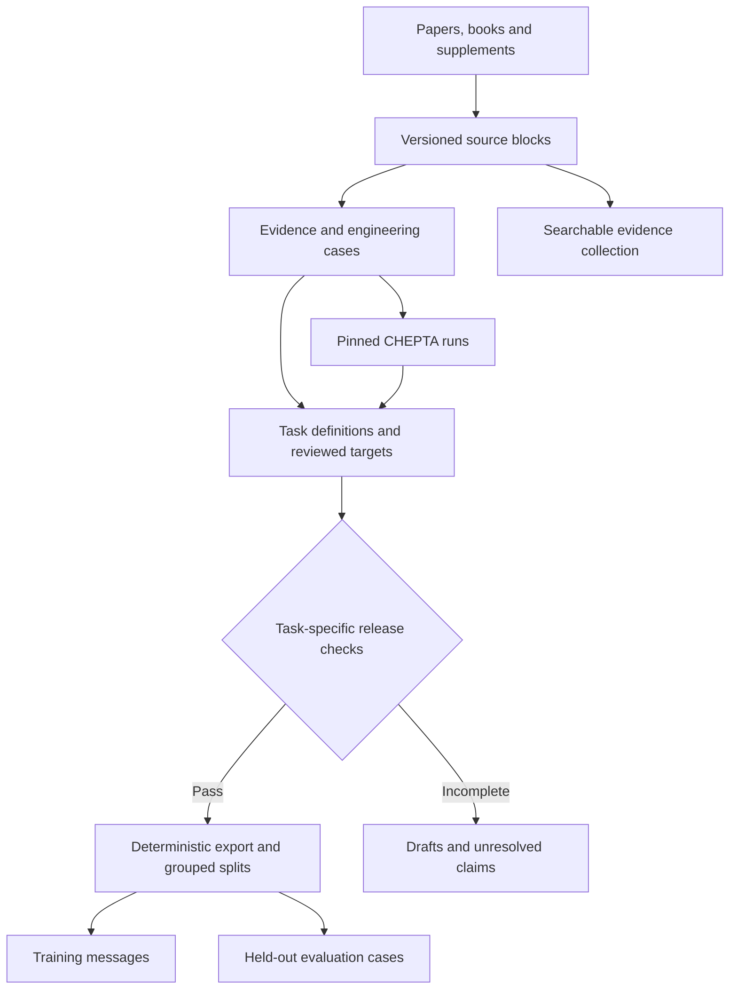

# Proposal: evidence records and task-specific training exports

Status: proposed, not implemented. Review date: 2026-10-30.

## Decision and scope

Keep the engineering workflow in [DATASET_DESIGN.md](../DATASET_DESIGN.md). Add a reproducible layer that turns reviewed evidence and executable cases into separate training tasks. Our diagrams describe how an engineer works; the missing part is how that work becomes model inputs, targets and fair tests.

The intended capability remains: identify a physical obstacle, justify a small set of operations, connect a general process sequence, and use CHEPTA to check it. This proposal concerns data architecture, not a new neural-network architecture. Repository inspection does not establish that fine-tuning will outperform an existing model with retrieval and tools.

## Information inspected

- [CITED] CHEPTA-Lab at commit `3694fa8e3bdc184478e89ecd77a01dc654d72f05`: design, project plan, templates, draft decisions and acceptance instructions. Evidence and targets are already separated conceptually; formal schemas and training exports are still missing.
- [CITED] [SciRIFF](https://github.com/allenai/SciRIFF), including [dataset creation](https://github.com/allenai/SciRIFF/blob/main/doc/dataset_creation.md), the Qasper task template and formatter: scientific datasets become task-specific instruction examples through templates and preprocessing. Borrow that separation, not its full training stack.
- [CITED] [Qasper baseline](https://github.com/allenai/qasper-led-baseline): reports answer and evidence performance separately. CHEPTA-Lab should likewise distinguish a plausible answer from a supported answer.
- [CITED] [Annotated materials syntheses](https://github.com/olivettigroup/annotated-materials-syntheses): source text is paired with annotations linking materials, operations, conditions and sequence. The inspected annotation file explicitly relates quantities and conditions to their entities. Borrow these typed relationships.
- [CITED] [PaperQA](https://github.com/Future-House/paper-qa): retrieves scientific evidence for cited answers. It is a retrieval application, not itself a paper-to-fine-tuning dataset. Borrow the separation between a searchable evidence collection and model training.
- [CITED] [Aviary](https://github.com/Future-House/aviary): represents agent actions and tool observations in scientific environments. Borrow explicit tool-call/result records; reinforcement learning is unnecessary for the first pilot.
- [MISSING] An accepted CHEPTA-Lab training release, a baseline score on held-out engineering tasks, and evidence that adapting a model improves those scores. No dataset size can guarantee that outcome.

These projects cover complementary pieces. None of the inspected repositories establishes a complete solution for learning general process-engineering judgment from simulation papers.

### A concrete limitation we must avoid

SciRIFF's [Qasper formatter](https://github.com/allenai/SciRIFF/blob/main/sciriff/instructions/formatters/qasper.py) filters evidence marked `FLOAT SELECTED`, skips records with no remaining evidence, and skips highlighted evidence containing `INLINEFORM`. Its input construction deliberately includes known evidence plus distractors.

For CHEPTA-Lab, preserve tables, equations and flowsheet connectivity. Curated evidence is appropriate for a task explicitly testing reasoning with supplied evidence; it cannot establish that a model can independently retrieve the evidence.

## Proposed architecture

One canonical collection should produce three separate outputs: retrieval material, training examples and evaluation cases. Avoid maintaining independently edited copies of the same scientific facts.

The arrows from CHEPTA runs apply to tasks that need calculations. Literature explanation tasks can proceed through their own evidence and review gates.

| Record | Minimum contents | Why it matters |
|---|---|---|
| Source block | Source ID, document version/hash, page/section, paragraph/table-cell/equation/figure locator, extraction method/version, rights status | Locate and correct a claim without re-extracting everything |
| Evidence claim | Block IDs, claim type, original value and units, conditions, uncertainty/limitations, transformations and review | Keep measured, author-simulated, assumed and Lab-derived information distinct |
| Engineering case | Components and mixture state, goals, constraints, original and normalized basis, stream/equipment relationships | Preserve the physical problem independently of one question |
| Decision | Obstacle, mechanism, candidate operation, expected state change, alternatives, applicability limits, supporting/contrary claim IDs | Encode why and when a choice is defensible |
| Task | Task type, model-visible inputs, allowed evidence/tools, target or scoring rubric, linked case/decisions/runs, split group | Make exactly what the model is learning explicit |
| Run | Engine revision, tool schema/version, input hash, ordered calls/results and IDs, warnings/errors, checks | Teach actual calculation and diagnosis |
| Release | Included record revisions, schema/exporter versions, split manifest, exclusions and review status | Rebuild and audit the same dataset |

A source block can initially be a manually verified table or paragraph. We do not need a universal PDF parser before the pilot. Store structured tables and typed flowsheet edges now; a future multimodal training export can use figures when justified.

Use JSON/JSONL and versioned JSON Schema initially. Relationships can be IDs in files; a graph database is not required.

## What one paper can teach

A paper can support several tasks, provided each target has evidence. More tasks from one paper do not count as more independent processes.

| Task | Input to the model | Target or scoring criteria |
|---|---|---|
| Explain a published choice | Operation, relevant state and source evidence | Concise mechanism, citations and limits; distinguish author explanation from our inference |
| Select a next operation | Mixture state, goal, constraints and applicable evidence | Defensible shortlist, exclusions and missing information; hide the published answer |
| Connect a process sequence | Feed, product specifications and supported unit capabilities | Connected operations with a stated purpose and unresolved feasibility checks |
| Use CHEPTA | Defined calculation request and available tool contracts | Valid call, actual observation, supported interpretation |
| Diagnose or abstain | Missing inputs, conflicting evidence or a failed run | Identify the specific problem and justified next action |
| Compare alternatives | Common basis, objectives, constraints and comparable results | Conditional trade-offs; no universal winner without an objective and sufficient evidence |

The engineering representation should capture: **state → obstacle → mechanism → operation → expected change → applicability limits → verification**. This is the transferable part. An equipment list alone is insufficient.

Keep short, checkable engineering justifications. Do not manufacture an author's reasoning or use long agent-generated narratives as truth. A new operating-condition variant requires supporting evidence or recalculation; paraphrasing does not create new physical coverage.

## Five changes to the current scaffolding

1. **Make provenance precise.** Extend the current string locator with stable block IDs and document versions. Attach evidence and inference classifications to individual claims. Preserve conflicting claims rather than silently replacing one.
2. **Replace implied review with explicit review.** Rename `reviewed_target` to `target`; add review records naming the reviewer type, record revision, decision and scope. Agent review and human engineering review remain distinct. Preserve old records through an explicit schema migration.
3. **Use task-specific acceptance gates.** The current blanket rule requires runnable inputs and outputs for every example. Propose a documented amendment: an evidence-grounded explanation needs source, engineering and rights review but no artificial simulation requirement. A quantitative process-performance target still needs executed calculations, appropriate comparison and review. Describing a paper's reported value is a different task from claiming CHEPTA reproduced it.
4. **Export genuine tool interactions.** Generate model-compatible messages and tool definitions from canonical records, with assistant calls linked to actual tool responses. Tool observations are context, not numbers for the model to invent. Preserve failed runs; train the supported diagnosis, not imitation of a failed action as the preferred action.
5. **Freeze grouped evaluation before augmentation.** Keep related papers, supplements, flowsheets, process families and capacity variants together under a documented grouping policy. Deduplicate overlapping source material. Assign groups before generating task variants; never randomly split individual questions from the same case.

The acceptance-policy amendment is only proposed here. Existing AGENTS.md rules continue to apply, and no draft becomes training-eligible through this document.

## Evaluation and training boundary

Maintain two clearly labeled settings:

- **Supplied-evidence test:** can the model reason correctly from the same evidence supplied to every compared model?
- **Retrieval-and-tool test:** can it find applicable evidence, call CHEPTA correctly, and interpret results? Do not preselect gold evidence using the hidden answer.

Score citation support, physical applicability, constraints, conditional alternatives, missing-data handling and actual tool outcomes separately. Multiple engineering solutions may be valid; matching a paper's equipment sequence is not the sole criterion.

Keep answers, review notes and future tool outputs out of learner inputs. For operation-selection tests, exclude source passages or figures that directly reveal the target equipment choice, or label the task as reconstruction. Publish exactly which documents were available during evaluation. Separate literature-assisted transfer from claims of independent novel design.

First compare an existing model with retrieval and CHEPTA against the same model after a small supervised adaptation. Use identical tools and evidence access. Train only on intended assistant responses/actions with the chosen trainer's supported masking; keep provenance in a linked sidecar. Inspect rendered chat examples before any training run.

New papers initially update evidence and retrieval. Retraining should follow a reviewed dataset release and a demonstrated learning need.

## Assumptions, alternatives and limits

- **Assumption:** engineers can review enough concise decisions. If false, retain draft data and prioritize a retrieval assistant rather than claiming expert training targets.
- **Assumption:** useful reasoning can be supervised separately from full-plant performance. If reviewers find the reasoning depends on unresolved physics, keep that task blocked or narrow its claim.
- **Assumption:** linked text, tables and connectivity suffice for the pilot. If figure-dependent tasks consistently lose essential information, add image-region evidence and evaluate a multimodal model.
- **Bias check:** published routes are selected successes, and familiar CHEPTA examples may favour available units. Include supported exclusions, unresolved alternatives and failures; do not label an unavailable unit physically unsuitable.
- **Alternative:** retrieval plus tools alone may meet the goal. Keep it as the baseline and stop at that if fine-tuning adds no reliable benefit.
- **Alternative:** raw-paper continued pretraining may help domain language, but does not by itself teach checked tool use or defensible design decisions. It is not the first experiment.
- **Alternative:** full agent reinforcement learning adds complexity before we have reliable task scoring. Defer it.

Reuse CHEPTA's property models, provenance and existing validation. Lab checks applicability and process results; it does not routinely repeat phase-equilibrium validation. Preserve original flow rates for reproduction and normalized bases for transfer. Recompute capacity-dependent sizing and limits.

## Small first implementation

Prove the architecture with existing material before collecting many more papers:

1. Define schemas and migrate one evidence/decision record, preserving provenance and draft status.
2. Prepare three task types: a sourced operation explanation, a next-operation task with explicit missing specifications, and an ethanol CHEPTA call/result interpretation using the existing run artifacts.
3. Build a deterministic exporter and checks for broken references, units/bases, task eligibility, hidden-target leakage and grouped splits.
4. Review the rendered examples. Freeze pilot evaluation tasks and record a baseline. A three-task demonstration checks the pipeline, not general engineering competence.
5. Expand independent cases only after the data path works. Publish reviewed releases on Hugging Face; keep canonical records and implementation history in this repository.

**Recommendation:** retain the current engineering design and add this evidence-to-task layer. Confidence is high that it improves traceability and reuse; whether it improves model competence remains an empirical question.

## Inspection record

Code/document inspection only; the external repositories were not installed or benchmarked.

| File inspected | Git blob SHA |
|---|---|
| SciRIFF README | `17fec6e4f03885ea99788dc44e35b183fd28ab38` |
| SciRIFF doc/dataset_creation.md | `b92d5378a5fe255cdb12d95701c750b09a8e3a8e` |
| SciRIFF sciriff/instructions/templates/qasper_abstractive_qa.yaml | `f40edf52e923ebfa63c7c46e97868e5a73d12b14` |
| SciRIFF sciriff/instructions/formatters/qasper.py | `a9e1425598ca1a4693540de7638af0b27438bf3d` |
| Annotated materials syntheses README | `ca5998a3d90e5c902e2c64f4661064483359ed71` |
| Annotated materials syntheses data/101002adma200903953.ann | `241d65bf7201500464ba3fcea08c7e693f52b400` |
| Qasper baseline README | `79d360548c2488bc4287f8ac5b022ef309cf4667` |
| PaperQA README | `af05b404aacd6aa3bc6792fcfb650902fc666c1f` |
| Aviary README | `26cc01eab8a4b8f86257b354af3693179a737ed7` |
